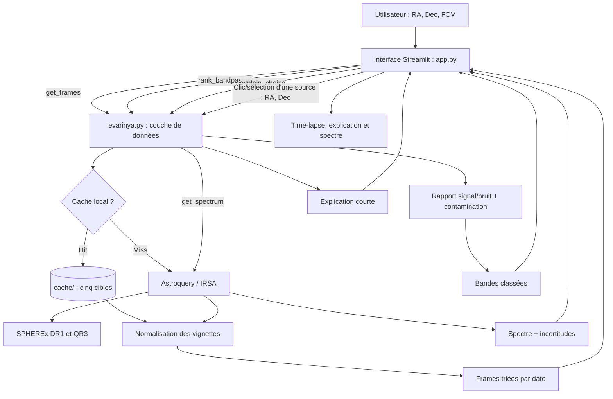

# Evarinya — architecture

Evarinya est une application Streamlit publique qui facilite l'exploration
temporelle d'images SPHEREx autour d'une position céleste. Elle aide à repérer
des sources potentiellement mobiles ; elle ne réalise pas d'identification
scientifique définitive.

## Organisation

| Élément | Responsabilité | Responsable |
| --- | --- | --- |
| `app.py` | Saisie RA/Dec/FOV, time-lapse, explication du classement et visualisation du spectre | Junior |
| `evarinya.py` | Accès IRSA, cache, normalisation des vignettes, classement des bandes et extraction du spectre | Diane |
| `cache/` | Produits pré-calculés pour les cinq cibles de démonstration | Équipe |
| `requirements.txt` | Dépendances Python de l'application | Équipe |

`app.py` ne contient pas de logique d'accès à IRSA : les appels aux données
passent par les fonctions publiques de `evarinya.py`. Ce module masque à
l'interface les détails des produits et des collections SPHEREx DR1 et QR3.

## Flux de données

## Contrat entre interface et données

- `get_frames(ra, dec, fov)` retourne des images ordonnées par date. Chaque
  vignette normalisée expose `image`, `observation_time` et `band`.
- `get_all_bands()` retourne les bandes réellement disponibles pour les
  produits pris en charge.
- `rank_bandpasses(frames)` retourne une liste du meilleur au moins bon choix.
  Chaque résultat expose `band`, `snr`, `contamination` et `score`.
- `explain_choice(best_band)` transforme les métriques en une phrase simple.
- `get_spectrum(ra, dec)` retourne les longueurs d'onde en micromètres, le
  flux et, si disponible, son incertitude.

Les structures de retour sont définies dans `evarinya.py` afin que le module
de données puisse évoluer sans coupler l'interface au format brut d'IRSA.
Les noms de colonnes, unités et indicateurs de qualité exacts doivent être
confirmés à partir des produits DR1/QR3 choisis avant l'implémentation.

## Cache de démonstration

Le cache doit contenir les produits normalisés de Barnard's Star, Epsilon
Indi B, WISE 0855, RW Aurigae et R Draconis. `cache/README.md` décrit la
convention de stockage à compléter par l'équipe. Les données réelles ne sont
pas générées par ce squelette : elles doivent être récupérées et vérifiées
avant d'être ajoutées au dépôt. L'application doit privilégier ces données
pour les cibles de démonstration afin de rester rapide et utilisable hors
ligne. Une position absente du cache nécessitera un accès à IRSA.

## Limites

- **Époque des positions :** certaines positions de catalogue utilisées pour
  retrouver les cibles peuvent être référencées à l'époque J2000 (année 2000).
  Le mouvement propre peut entraîner un décalage notable, en particulier pour
  les objets proches. Il faut vérifier et, si nécessaire, propager les
  coordonnées à l'époque des observations avant l'appariement.
- **Observations à des dates différentes :** un spectre assemblé à partir de
  plusieurs observations peut combiner des époques distinctes. Les objets
  variables ou mobiles peuvent donc présenter des incohérences ; les dates et
  incertitudes doivent être affichées et interprétées avec prudence.
- **Suggestion de classe :** une catégorie telle que « candidat naine brune »
  est une piste à examiner, et non une identification ou une confirmation.
  L'application ne remplace ni une analyse scientifique ni une validation
  par des données indépendantes.
- **Couverture et disponibilité :** les produits, indicateurs qualité,
  formats de cutout et permissions peuvent différer entre DR1 et QR3. La
  disponibilité effective doit être vérifiée dans IRSA ; le squelette ne
  suppose pas de schéma précis qui n'aurait pas été confirmé.

## Utilisation de l'Intelligence Artificielle

Claude (Anthropic) a aidé à planifier l'architecture et à écrire du code pour
le projet. L'équipe a vérifié le contenu généré et reste responsable de sa
validation, de son exactitude et de son adéquation aux ressources officielles
de la NASA.

## Déploiement

Le déploiement cible Streamlit Community Cloud depuis GitHub. Les dépendances
sont installées depuis `requirements.txt`. Les identifiants ou secrets ne
doivent pas être ajoutés au dépôt ; les requêtes publiques vers IRSA doivent
également gérer les erreurs réseau, les limites de service et l'absence de
résultats.